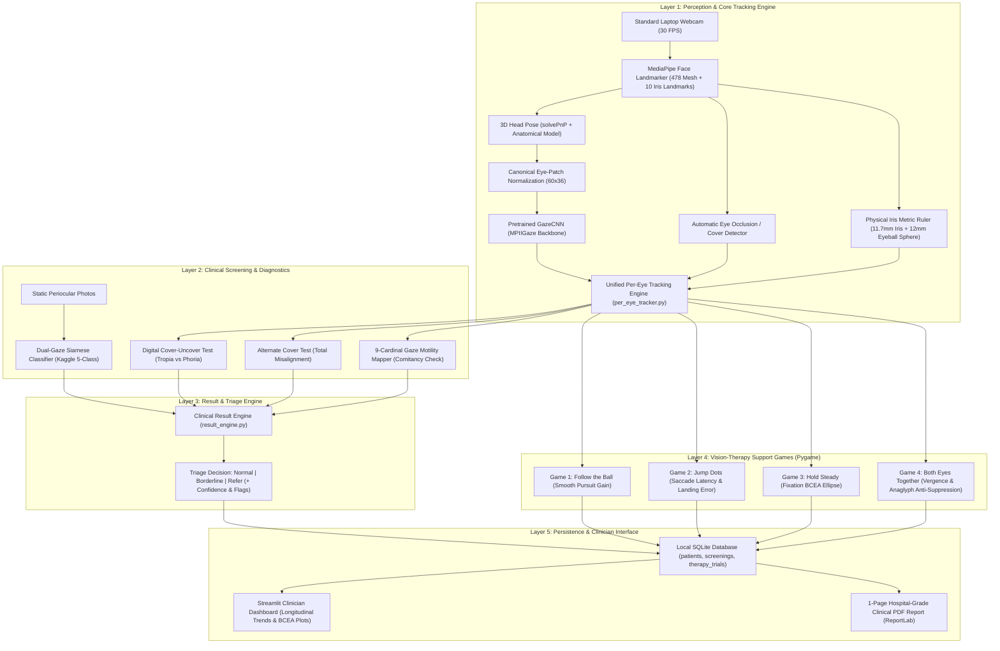

# Webcam-Based Strabismus Screening & Vision-Therapy Support System
## Engineering Blueprint, Architecture & Sequential Implementation Pipeline

---

## 1. Problem Statement

### 1.1 Clinical Context
Strabismus (ocular misalignment / squint) affects 2–4% of children. If undetected during early visual development, the brain suppresses the deviating eye's image to avoid double vision (diplopia), leading to irreversible **amblyopia (lazy eye)**. 

Gold-standard clinical tests—the **Cover-Uncover Test**, **Alternate Cover Test (ACT)**, and **9-Cardinal Gaze Motility Exam**—require skilled strabismus specialists in specialized clinics. Furthermore, commercial vision-therapy systems (e.g., CureSight) rely on expensive proprietary eye-tracking hardware ($1,000+), making continuous screening and home therapy monitoring inaccessible to most patients.

### 1.2 Engineering Objective
Build a low-cost, software-only platform that operates on any standard laptop webcam (30 FPS, 720p) to:
1. **Track both eyes independently** in real time, converting pixel movements into clinically standard units: **Angular Degrees ($^\circ$)** and **Prism Diopters ($\Delta\text{PD}$)**.
2. **Automate clinical screening protocols** (Cover Test, Alternate Cover Test, 9-Cardinal Gaze) with automatic eye-occlusion detection.
3. **Classify and triage** ocular alignment into explainable clinical categories (`Normal`, `Borderline`, `Refer`) with calculated confidence levels—functioning strictly as a screening aid.
4. **Deliver 4 adaptive vision-therapy exercise games** that actively measure clinical motor recovery metrics: Smooth Pursuit Gain, Saccadic Latency/Accuracy, Fixation Stability via **BCEA (Bivariate Contour Ellipse Area)**, and Binocular Vergence Alignment (with optional Red-Cyan dichoptic stimulation).
5. **Persist longitudinal patient records** in an anonymized local SQLite database, visualized via an interactive **Streamlit Clinician Dashboard** with a **1-page exportable clinical PDF summary**.

---

## 2. Complete Project Architecture



---

## 3. Step-by-Step Implementation Pipeline

Each step represents a self-contained engineering milestone. Once a step's **Definition of Done** is fulfilled, it serves as the stable foundation for the next step.

```mermaid
flowchart LR
    S0["Step 0: Completed Foundations"] --> S1["Step 1: Unified Per-Eye Engine"]
    S1 --> S2["Step 2: Alternate Cover & Auto-Occlusion"]
    S2 --> S3["Step 3: Result & Triage Engine"]
    S3 --> S4["Step 4: Pygame Therapy Games"]
    S4 --> S5["Step 5: SQLite Database & Schema"]
    S5 --> S6["Step 6: Streamlit Dashboard & PDF Export"]
    S6 --> S7["Step 7: Volunteer Validation & Evaluation"]
```



---

### Step 0: Foundations Already Completed (Repo Inventory)
* [x] **MPIIGaze Backbone**: `GazeCNN` trained in Colab (`models/gaze_model_p00.pth`).
* [x] **3D Normalization**: Head pose via `solvePnP` with corrected 3D face model (`FACE_MODEL` mouth Y = 65mm in `core/normalize.py`).
* [x] **9-Point Screen Calibration**: Polynomial / Ridge regression mapping raw gaze to screen pixels (`core/gaze_to_screen.py`).
* [x] **Kaggle 5-Class Siamese Classifier**: `DualGazeStrabismusNet` trained on 509 clinical eye strips (`core/train_strabismus_net.py`, `models/strabismus_classifier.pth`).
* [x] **Initial Cover Test Prototype**: Refixation saccade detection on video and webcam (`core/cover_test.py`).

---

### Step 1: Unified Per-Eye Tracking Engine  [COMPLETED]
* **File Created**: [`core/per_eye_tracker.py`](file:///c:/Users/Gnana%20Teja%20Varma/eye-gaze-strabismus/core/per_eye_tracker.py)
* **Status**: Fully Implemented & Tested
* **Key Capabilities Delivered**:
  1. **Anatomical Scale Conversion**: Uses $11.7\,\text{mm}$ iris diameter as a self-calibrating ruler.
  2. **Spherical Eyeball Kinematics**: Implements $\theta = \arcsin(d/R)$ with $R = 12.0\,\text{mm}$.
  3. **Vergence Compensation**: Accounts for near-field viewing convergence ($Z \approx 600\,\text{mm}$, $\text{IPD} \approx 62\,\text{mm}$).
  4. **Inter-Ocular Misalignment**: Outputs $\Delta\text{PD}_{\text{horizontal}}$, $\Delta\text{PD}_{\text{vertical}}$, and angular degrees.
  5. **Automatic Cover Detection**: Real-time identification of `"NONE"`, `"OD"`, or `"OS"` occlusion.
  6. **RockSolidFilter**: Two-stage adaptive filter preserving saccades while dampening high-frequency landmark jitter.
  7. **Diagnostic HUD**: Dual PiP cards, live angle readouts, Prism Diopter meters, and real-time FPS overlay.

---

### Step 2: Automated Clinical Screening Protocols
* **Module 2.1: Saccade & Eye Movement Utility** [`core/eye_movement_analyzer.py`](file:///c:/Users/Gnana%20Teja%20Varma/eye-gaze-strabismus/core/eye_movement_analyzer.py) [COMPLETED]
  * I-VT velocity segmentation ($v > 30^\circ/\text{s}$).
  * Central-difference noise-damped velocity filtering for 30 FPS webcam streams.
  * Saccadic refixation event extraction (onset latency, amplitude in deg & $\Delta\text{PD}$, direction, peak/mean velocity, strabismus correlation).
  * Fixation stability evaluation via Bivariate Contour Ellipse Area (BCEA) and drift velocity.
  * Smooth pursuit gain calculator ($G = v_{\text{eye}} / v_{\text{target}}$).
* **Module 2.2: Automated Cover-Uncover Test** [`core/cover_test.py`](file:///c:/Users/Gnana%20Teja%20Varma/eye-gaze-strabismus/core/cover_test.py) [COMPLETED]
  * Condition-gated clinical state machine (no blind timers; advances ONLY upon verified compliance).
  * Automatic occlusion gating via `PerEyeTracker` (prevents skipping, detects wrong-eye covering).
  * Central bullseye fixation checking with dynamic circular progress arc.
  * Real-time saccadic refixation extraction via `EyeMovementAnalyzer`.
  * Auto-generates standardized clinical JSON reports and high-resolution displacement plots.
* **Module 2.3: Alternate Cover Test (ACT)** [`core/alternate_cover_test.py`](file:///c:/Users/Gnana%20Teja%20Varma/eye-gaze-strabismus/core/alternate_cover_test.py) [COMPLETED]
  * Dissociates binocular fusion completely to measure Total Dissociated Deviation ($\text{Manifest Tropia} + \text{Latent Phoria}$).
  * Condition-gated 4-cycle alternating protocol (8 total transitions, 2.0s hold per eye).
  * Rapid-switch grace window ($600\,\text{ms}$) allowing hand/card motion across the nose without resetting test.
  * Real-time refixation saccade detection on observed fellow eye per transition via `EyeMovementAnalyzer`.
  * Computes Mean, Std Dev, Dominant Direction (EXO / ESO / ORTHO), and Hering's Law symmetry ratio.
  * Auto-generates standardized clinical ACT JSON report, text summary, and high-res multi-panel trajectory plots.
* **Module 2.4: 9-Cardinal Gaze Motility Matrix** [`core/screen_strabismus.py`](file:///c:/Users/Gnana%20Teja%20Varma/eye-gaze-strabismus/core/screen_strabismus.py) [COMPLETED]
  * Fully condition-gated 9-position visual motility protocol with PerEyeTracker gaze direction checks.
  * Measures horizontal/vertical misalignment ($\Delta\text{PD}$), BCEA fixation stability, and gaze angles across all 9 positions.
  * Computes Incomitancy Spread ($\text{Spread} = \max(\Delta\text{PD}) - \min(\Delta\text{PD})$) to classify Comitant ($\le 5.0\,\Delta\text{PD}$), Borderline ($5\text{--}8\,\Delta\text{PD}$), or Incomitant ($> 8.0\,\Delta\text{PD}$).
  * Analyzes extraocular muscle fields for paretic underaction or restrictive strabismus.
  * Auto-generates standardized 5-section clinical report, JSON file, and publication-quality $3 \times 3$ heatmap & Hess-style displacement plots.

---

### Step 3: Result & Triage Engine [COMPLETED]
* **File Created**: [`core/result_engine.py`](file:///c:/Users/Gnana%20Teja%20Varma/eye-gaze-strabismus/core/result_engine.py)
* **Status**: Fully Implemented & Verified with 100% Test Pass Rate
* **Key Capabilities Delivered**:
  1. **Noise-Floor Guardrail**:
     * Implements a $3.5\,\Delta\text{PD}$ sensor noise floor threshold protecting against false positives on healthy subjects.
  2. **Manifest vs. Latent Dissection**:
     * Separates manifest tropia (from Cover-Uncover saccades) from latent phoria ($\text{ACT Total} - \text{Manifest}$).
  3. **Three-Tier Rule Engine**:
     * **NORMAL**: Primary alignment $< 6.0\,\Delta\text{PD}$, no manifest saccades ($< 4.0\,\Delta\text{PD}$), comitant motility ($\text{Spread} \le 5.0\,\Delta\text{PD}$).
     * **BORDERLINE**: Mild phoria ($4.0\text{--}10.0\,\Delta\text{PD}$), borderline spread ($5.0\text{--}8.0\,\Delta\text{PD}$), or noisy data ($< 80\%$ valid frames $\to$ flags `"Retest Recommended"`).
     * **REFER**: Manifest refixation $> 8.0\,\Delta\text{PD}$ (Esotropia / Exotropia), total deviation $\ge 10.0\,\Delta\text{PD}$, or incomitant motility limitation ($\text{Spread} > 8.0\,\Delta\text{PD}$).
  4. **Multi-Protocol Ingestion & Auto-Save**:
     * Ingests JSON reports from Modules 2.2, 2.3, and 2.4 and generates unified `.json` and `.txt` clinical triage verdicts.
  5. **100% Verified Definition of Done**:
     * 6-case automated unit test suite passing with 100% accuracy on Normal, Exotropia, Esotropia, Incomitancy, Latent Phoria, and Sensor Noise.

---

### Step 4: Vision-Therapy Support Game Suite
* **Directory to Create**: `therapy/`
* **Files**: `game_runner.py`, `game_pursuit.py`, `game_saccades.py`, `game_fixation.py`, `game_vergence.py`
* **Prerequisites**: Step 1 (`PerEyeTracker`).
* **Technical Implementation (Pygame-based, 60 FPS rendering)**:
  1. **Game 1: Follow the Ball (Smooth Pursuit)**
     * Visual: High-contrast target moves along smooth circular/Lissajous curves.
     * Metrics:
       * **Pursuit Gain**: $G = \frac{\bar{v}_{\text{eye}}}{\bar{v}_{\text{target}}}$ (Ideal $\approx 0.9\text{--}1.0$).
       * **Catch-up Saccade Count**: Frequency of sudden corrective jumps when lag $> 4^\circ$.
     * Adaptive rule: Ball speed scales up if pursuit gain $> 0.85$ for 5 seconds; slows down if gain $< 0.60$.
  2. **Game 2: Jump Dots (Saccadic Training)**
     * Visual: Random target jumps to eccentric positions; player must fixate target to trigger next jump.
     * Metrics:
       * **Saccadic Latency**: Delay (in ms) from target appearance to eye movement onset.
       * **Landing Accuracy**: Radial error (in pixels / degrees) of the initial saccade termination.
  3. **Game 3: Hold Steady (Fixation Stability)**
     * Visual: Bullseye target with a gentle pulsing ring. Player keeps gaze inside the ring.
     * Metric: **Bivariate Contour Ellipse Area (BCEA)** encompassing 68.2% of fixation points:
       $$\text{BCEA} = 2 \pi k \sigma_x \sigma_y \sqrt{1 - \rho^2} \quad (k = 1.14)$$
       *Smaller BCEA = superior fixation steadiness (key clinical marker of amblyopia recovery).*
  4. **Game 4: Both Eyes Together (Vergence & Anti-Suppression)**
     * Visual: Binocular tracking target with dynamic depth scaling (target grows/shrinks simulating near/far vergence).
     * Metric: Percentage of trial duration where inter-ocular misalignment remains $< 6.0\,\Delta\text{PD}$.
     * **Anaglyph Dichoptic Feature (Bonus)**: Target drawn in Pure Red (visible only to non-deviating eye), background anchor drawn in Pure Cyan (visible only to deviating eye) using standard red-cyan glasses to stimulate binocular cortical fusion.
* **Definition of Done**: All 4 games are playable using live webcam gaze control, adapt difficulty in real time, and return structured session score dictionaries upon completion.

---

### Step 5: Session Database & Persistence Layer
* **Directory to Create**: `data/`
* **Files**: `data/schema.sql`, `data/session_db.py`
* **Prerequisites**: Steps 2, 3, and 4 (Data contracts defined).
* **Technical Implementation**:
  * Local SQLite relational database (`data/strabismus_sessions.db`).
  * Relational Schema:
    * `patients`: `patient_id` (anonymized string, e.g. `P_1042`), `age_group`, `created_at`, `notes`.
    * `screening_records`: `screening_id`, `patient_id`, `timestamp`, `test_type` (`COVER`, `ACT`, `NINE_POINT`), `triage_result` (`NORMAL`, `BORDERLINE`, `REFER`), `deviation_horizontal_pd`, `deviation_vertical_pd`, `confidence`, `comitancy_flag`, `details_json`.
    * `therapy_sessions`: `session_id`, `patient_id`, `timestamp`, `game_id`, `duration_seconds`, `difficulty_level`, `score`, `pursuit_gain`, `saccade_latency_ms`, `bcea_deg2`, `alignment_retention_pct`.
* **Definition of Done**: Unit test confirms insert, update, query, and longitudinal history retrieval functions for any patient ID.

---

### Step 6: Clinician Dashboard & 1-Page PDF Generator
* **Directory to Create**: `dashboard/`, `reports/`
* **Files**: `dashboard/app.py` (Streamlit), `reports/pdf_generator.py` (ReportLab)
* **Prerequisites**: Step 5 (`session_db.py`).
* **Technical Implementation**:
  1. **Streamlit Clinician Dashboard**:
     * Patient Switcher: Dropdown to select anonymized patient ID.
     * Summary Cards: Latest Triage Status, Primary Alignment ($\Delta\text{PD}$), Average BCEA, Total Therapy Hours.
     * Interactive Trend Charts (Plotly):
       * Longitudinal Fixation Stability: Plotting BCEA over successive sessions (showing therapeutic reduction in fixation flutter).
       * Smooth Pursuit Gain over time (trending toward 1.0).
       * Saccadic Latency reduction curve.
     * 9-Cardinal Gaze Heatmap: $3 \times 3$ grid displaying measured misalignment across motility angles.
  2. **1-Page Clinical Summary PDF**:
     * Generated via ReportLab in $< 1\,\text{second}$.
     * Clean header: Clinic/Institution name, Patient Anonymous ID, Session Date.
     * Screening Triage Banner: Prominent color-coded box (`NORMAL` / `BORDERLINE` / `REFER`) with confidence percentage.
     * High-res embedded graphs: Cover Test Refixation Curve + Fixation BCEA Ellipse.
     * Actionable Clinical Summary: Detailed deviation in Prism Diopters, comitancy findings, and therapy adherence metrics.
     * Prominent Footer: Medical screening disclaimer.
* **Definition of Done**: Launching `streamlit run dashboard/app.py` renders all patient charts smoothly, and clicking "Generate Clinical PDF" immediately downloads an elegant 1-page PDF.

---

### Step 7: System Validation & Benchmarking
* **Directory to Create**: `evaluation/`
* **Files**: `evaluation/noise_floor_test.py`, `evaluation/repeatability_analysis.py`
* **Prerequisites**: Steps 1–6 complete.
* **Technical Implementation**:
  1. **Noise Floor Assessment**: Record 10 healthy adult volunteers looking at stationary targets. Calculate standard deviation and 95% confidence intervals of left-right gaze disparity to establish the minimum resolvable misalignment limit.
  2. **Induced Strabismus Validation**: Healthy volunteers simulate inward/outward convergence; verify system reliably triggers `REFER` with correct directional sign.
  3. **Repeatability & Bland-Altman Analysis**: Run test-retest trials across multiple sessions to calculate repeatability coefficients and generate publication-ready Bland-Altman agreement plots.
  4. **Latency & Throughput Benchmark**: Confirm end-to-end pipeline maintains $\ge 25\text{--}30\,\text{FPS}$ on a standard laptop CPU without GPU acceleration.

---

## 4. End-to-End Operational Workflow (How the Final System Works)

When the entire project is completed, the clinical operator or patient follows this seamless flow:

```
┌────────────────────────────────────────────────────────┐
│               1. Patient Profile Selection             │
│   (Enter anonymized ID e.g. "P_101" in launcher UI)    │
└──────────────────────────┬─────────────────────────────┘
                           │
                           ▼
┌────────────────────────────────────────────────────────┐
│             2. Quick 9-Point Eye Calibration           │
│  (Fixate 9 bullseye targets to compute personal scale) │
└──────────────────────────┬─────────────────────────────┘
                           │
                           ▼
┌────────────────────────────────────────────────────────┐
│             3. Automated Clinical Screening            │
│  - Automated Cover-Uncover Test (OD & OS)              │
│  - Alternate Cover Test (ACT)                          │
│  - 9-Cardinal Gaze Motility Matrix                     │
│  ==> Instant Triage Card: NORMAL | BORDERLINE | REFER  │
└──────────────────────────┬─────────────────────────────┘
                           │
                           ▼
┌────────────────────────────────────────────────────────┐
│             4. Vision-Therapy Game Session             │
│  - Game 1: Smooth Pursuit (Catch the ball)             │
│  - Game 2: Saccades (Rapid dot jumps)                  │
│  - Game 3: Fixation Stability (Hold steady in ring)    │
│  - Game 4: Vergence Alignment (Anti-suppression)       │
└──────────────────────────┬─────────────────────────────┘
                           │
                           ▼
┌────────────────────────────────────────────────────────┐
│           5. Automatic Data Persistence (SQLite)       │
│  (Saves all test metrics, refixations, and BCEA)       │
└──────────────────────────┬─────────────────────────────┘
                           │
                           ▼
┌────────────────────────────────────────────────────────┐
│         6. Streamlit Dashboard & 1-Page PDF Export     │
│  - Clinician inspects recovery trends and motility map │
│  - 1-Click download of Hospital-Grade Clinical PDF     │
└────────────────────────────────────────────────┘
```

---

## 5. Clean File Structure of the Final System

```text
eye-gaze-strabismus/
├── core/
│   ├── per_eye_tracker.py          # Unified per-eye tracking engine (Step 1)
│   ├── cover_test.py               # Auto-occlusion Cover-Uncover test (Step 2)
│   ├── alternate_cover_test.py     # Rapid Alternate Cover Test (Step 2)
│   ├── screen_strabismus.py        # 9-Cardinal gaze motility mapper
│   ├── result_engine.py            # Three-tier triage & explanation engine (Step 3)
│   ├── normalize.py                # Anatomical 3D head-pose & eye-patch normalization
│   └── train_strabismus_net.py     # Siamese 5-class image classifier
├── therapy/
│   ├── game_runner.py              # Therapy game launcher & menu (Step 4)
│   ├── game_pursuit.py             # Game 1: Smooth pursuit gain
│   ├── game_saccades.py            # Game 2: Saccade latency & accuracy
│   ├── game_fixation.py            # Game 3: Fixation stability & BCEA
│   └── game_vergence.py            # Game 4: Binocular vergence & anaglyph mode
├── data/
│   ├── schema.sql                  # SQLite relational table schemas (Step 5)
│   ├── session_db.py               # SQLite session CRUD manager (Step 5)
│   └── strabismus_sessions.db      # Local SQLite database file
├── dashboard/
│   └── app.py                      # Streamlit interactive clinician dashboard (Step 6)
├── reports/
│   └── pdf_generator.py            # 1-page ReportLab clinical PDF export (Step 6)
├── evaluation/
│   ├── noise_floor_test.py         # Volunteer noise floor benchmark (Step 7)
│   └── repeatability_analysis.py   # Bland-Altman repeatability evaluation (Step 7)
├── models/
│   ├── face_landmarker.task        # MediaPipe face mesh asset
│   ├── gaze_model_p00.pth          # MPIIGaze GazeCNN backbone weights
│   └── strabismus_classifier.pth   # Siamese strabismus classifier weights
├── requirements.txt
├── README.md
└── PROJECT_BLUEPRINT.md            # Living roadmap & implementation blueprint
```
